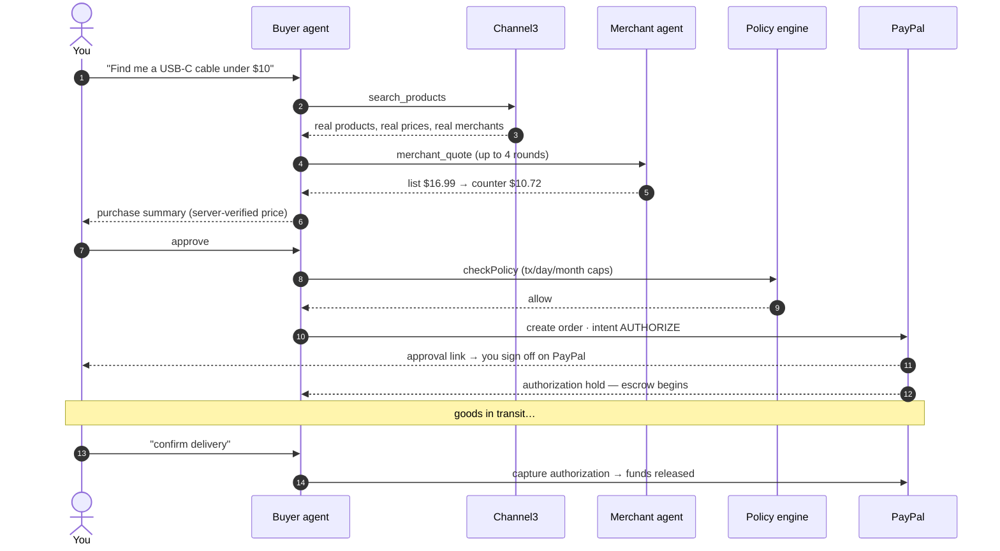
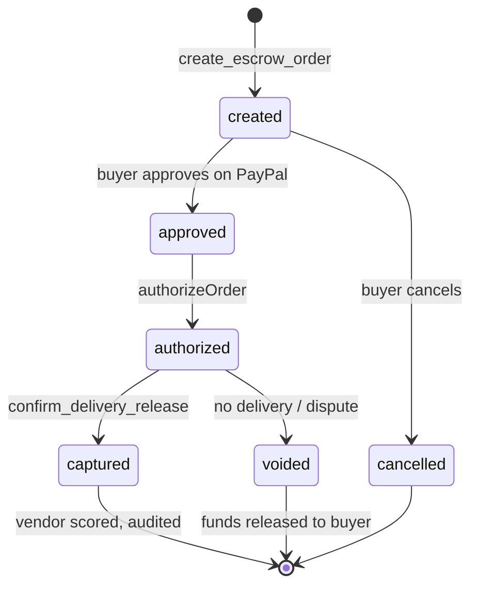
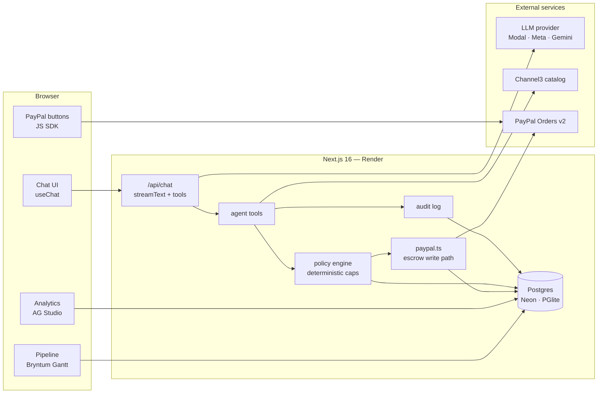

<div align="center">


# Parley

**Procurement that negotiates.**

An agentic procurement platform for solopreneurs and micro-businesses —
the procurement department they can't afford. A buyer agent searches real
products, negotiates price with merchant-side agents (A2A), and pays through
**agentic escrow on PayPal**: authorized when you approve, captured only
when delivery is confirmed.

[](https://parley-wt1k.onrender.com)
[](https://developer.paypal.com)
[](https://nextjs.org)
[](https://www.typescriptlang.org)
[](LICENSE)

Built for the **PayPal AI Hackathon** · [Demo](https://parley-wt1k.onrender.com) · [Architecture](#architecture) · [Security model](#security-model) · [Quickstart](#quickstart)

</div>

---

## Contents

| | | | |
|---|---|---|---|
| [The problem](#the-problem) | [How it works](#how-it-works) | [Not a chatbot](#why-its-not-a-chatbot-with-a-checkout-button) | [Agent tools](#agent-tools) |
| [Architecture](#architecture) | [Security model](#security-model) | [Database](#database) | [Design system](#design-system) |
| [Tech stack](#tech-stack) | [Quickstart](#quickstart) | [Escrow flow](#testing-the-escrow-flow-sandbox) | [Deploy](#deploy) |
| [Business model](#business-model) | [Roadmap](#roadmap) | [License](#license) | [Live demo](https://parley-wt1k.onrender.com) |

---

## The problem

An Etsy seller, a freelancer, a corner café — they all buy supplies, but none
of them have a procurement team. They overpay because they can't compare and
negotiate at scale, and they eat the risk when a vendor doesn't deliver: card
charges are instant, disputes are slow, and "buyer protection" is a claim
process, not a control.

**Parley inverts that.** An agent does the comparing and negotiating. PayPal
does the settling. And the money doesn't move until the goods arrive.

## How it works



If the goods never show up, the authorization is **voided** — the funds were
held, never captured. That's the difference between escrow and a chargeback.

### Escrow lifecycle



## Why it's not a chatbot with a checkout button

| | |
|---|---|
| **Prices never come from the model** | `create_escrow_order` resolves amounts server-side from the product cache or an accepted negotiation quote. The LLM selects a product ID — it cannot invent a number that reaches PayPal. |
| **Deterministic policy gates every order** | Per-tx, daily, and monthly caps live in `policies` and are evaluated in code (`src/lib/policy.ts`) — not in the prompt. The agent proposes; it cannot spend. |
| **Human approves every payment** | The PayPal approval link/button is the last mile. The agent never touches credentials. |
| **Capture only after delivery** | `AUTHORIZE` intent, never `CAPTURE`. Releasing funds is a separate, explicit, gated step. |
| **Everything is audited** | Actor, action, rationale, token count, and cost — append-only and rendered in the analytics workspace. |

## Agent tools

| Tool | What it does |
|---|---|
| `search_products` | Live product search via Channel3 — title, price, merchant, URL. Results cache server-side; later tools can only reference these IDs. |
| `merchant_quote` | Agent-to-agent negotiation. Up to 4 rounds; an accepted quote becomes the order price. |
| `create_escrow_order` | Server-side price resolution → `checkPolicy` → PayPal `AUTHORIZE` order → local order + audit → approval URL. |
| `get_escrow_status` | Reads live PayPal status of an escrow order. |
| `confirm_delivery_release` | Captures the authorization after delivery confirmation — the release valve of the escrow. |
| `list_orders` | Local order mirror — PayPal IDs, status, amounts. |
| **PayPal Agent Toolkit** | Invoices, disputes, transaction lookup, shipment tracking, payment insights — normalized to AI SDK v7. |

## Architecture



### Project map

```
src/
├── app/
│   ├── page.tsx                  # Buyer agent chat UI
│   ├── analytics/                # AG Studio workspace — orders, agent activity, vendors, alerts
│   ├── pipeline/                 # Bryntum Gantt — escrow lifecycle per order
│   └── api/
│       ├── chat/                 # Agent loop — streamText + tools + provider switch
│       ├── health/               # Liveness + integration status
│       ├── paypal/return|cancel/ # PayPal checkout return handlers
│       ├── analytics-data/       # Feeds AG Studio data sources
│       └── pipeline-data/        # Feeds the Gantt
├── lib/
│   ├── agent/
│   │   ├── system.ts             # Buyer agent system prompt + guardrails
│   │   ├── merchant.ts           # Merchant-side agent persona (A2A counterparty)
│   │   └── tools.ts              # search / negotiate / escrow / release / list
│   ├── paypal.ts                 # Orders v2 REST client — the only escrow write path
│   ├── paypal-toolkit.ts         # Agent Toolkit — invoices, disputes, txns, insights
│   ├── channel3.ts               # Product search, normalized to ProductCard
│   ├── policy.ts                 # Deterministic spend gate — tx/day/month caps
│   ├── audit.ts                  # Append-only action + token-cost log
│   ├── env.ts                    # Centralized server-side env access
│   └── db/
│       ├── schema.ts             # policies · orders_local · audit_log · vendor_scores · alerts
│       └── index.ts              # Drizzle — Neon (DATABASE_URL) or PGlite fallback
├── render.yaml                   # Render Blueprint — web service + env contract
└── neon.ts                       # Neon project wiring
```

## Security model

These are invariants, not features — the code enforces them:

> 1. **Money amounts are never model output.** Server-side price resolution only.
> 2. **`checkPolicy` cannot be bypassed** — it runs before every PayPal call, and tool retries can't route around it.
> 3. **No `CAPTURE` before delivery confirmation.** Authorization and capture are separate API calls with separate gates.
> 4. **Idempotent writes** — every mutating PayPal call sends a fresh `PayPal-Request-Id`.
> 5. **Secrets stay server-side.** Only `NEXT_PUBLIC_*` variables reach the browser; the PayPal secret never does.
> 6. **Tool results are data.** The system prompt instructs the model to treat tool output as untrusted content, never as instructions.
> 7. **Audit never lies.** `audit()` wraps every consequential action and fails safe — a logging problem can never block or corrupt a payment path.

## Database

Five tables, one schema, two drivers — `ensureDb()` bootstraps DDL and seeds
the default policy on first run:

| Table | Purpose |
|---|---|
| `policies` | Per-tx / daily / monthly spend caps, autonomous limit, vendor allowlists |
| `orders_local` | Local mirror of PayPal order state — IDs, amounts, escrow stage |
| `audit_log` | Append-only agent/system actions with rationale, tokens, cost |
| `vendor_scores` | Merchant reputation — delivery rate, disputes, response metrics |
| `alerts` | Watchdog findings — price hikes, duplicate charges, overdue delivery |

**Default policy** — `$250`/tx · `$750`/day · `$3,000`/month · `$50` autonomous limit.

## Design system

A restrained paper-and-ink palette with a single teal accent — procurement is
a trust product, so it looks like one.

| Token | Value | Use |
|---|---|---|
| `paper` | `#fafaf8` | Page background |
| `card` | `#ffffff` | Surfaces |
| `ink` | `#17150f` | Primary text |
| `ink-soft` | `#6b675c` | Secondary text |
| `line` | `#e8e5dd` | Hairline borders |
| `accent` | `#0f766e` | Brand + primary actions |
| `accent-strong` | `#115e59` | Hover / emphasis |
| `accent-soft` | `#d7f0ec` | Tinted fills |
| `ok` / `warn` / `danger` | `#15803d` / `#b45309` / `#b91c1c` | Escrow states, alerts |

Typography — **Space Grotesk** for display, **Inter** for UI text.

## Tech stack

| Layer | Technology |
|---|---|
| App | Next.js 16 (App Router, Turbopack) · React 19 · TypeScript · Tailwind v4 |
| Agent | Vercel AI SDK v7 — `streamText`, tools, `useChat` |
| LLM | Pluggable — **Modal** (GLM-5.3-Flash, dedicated endpoint) · **Meta Model API** (`muse-spark-1.3`) · **Gemini** fallback. Switch with `LLM_PROVIDER`. |
| Payments | PayPal Orders v2 (`AUTHORIZE`/`authorize`/`capture`/`void`) + Agent Toolkit + JS SDK buttons |
| Catalog | Channel3 product search API |
| Database | Neon Postgres (prod) · embedded PGlite (local) — same Drizzle schema |
| Analytics | AG Grid Enterprise + AG Studio report builder (`/analytics`) |
| Timeline | Bryntum Gantt — escrow lifecycle as a project plan (`/pipeline`) |
| Hosting | Render Blueprint (`render.yaml`) · health check `/api/health` |

## Quickstart

```bash
git clone https://github.com/HCHAPS404/PARLEY.git
cd parley
npm ci
cp .env.example .env.local   # fill in your keys
npm run dev                  # http://localhost:3000
```

First run bootstraps the local PGlite database automatically — no migrations needed.

<details>
<summary><strong>Environment variables</strong> — full reference</summary>

| Variable | Required | Notes |
|---|---|---|
| `PAYPAL_CLIENT_ID` / `PAYPAL_CLIENT_SECRET` | required | developer.paypal.com → Apps & Credentials → **Sandbox** app |
| `NEXT_PUBLIC_PAYPAL_CLIENT_ID` | required | Same client ID — exposed to the browser for PayPal JS SDK |
| `PAYPAL_ENV` | required | `sandbox` for the hackathon |
| `CHANNEL3_API_KEY` | required | Product catalog search |
| `LLM_PROVIDER` | required | `modal` \| `meta` \| `google` |
| `MODAL_API_KEY` / `MODAL_BASE_URL` / `MODAL_MODEL` | one LLM | Modal Shared Endpoint proxy token (`wk-….ws-…`) |
| `META_API_KEY` / `META_BASE_URL` / `META_MODEL` | one LLM | Meta Model API key (`LLM_…`), model `muse-spark-1.3` |
| `GOOGLE_GENERATIVE_AI_API_KEY` | one LLM | Gemini fallback |
| `DATABASE_URL` | prod only | Neon Postgres — empty = embedded PGlite locally |
| `CRON_SECRET` | prod only | Guards `/api/jobs/*` |
| `NEXT_PUBLIC_APP_URL` | prod only | e.g. `https://parley-wt1k.onrender.com` — PayPal return URLs |
| `NEXT_PUBLIC_AG_GRID_LICENSE` | optional | AG Grid Enterprise / AG Studio license |
| `NEXT_PUBLIC_BRYNTUM_LICENSE` | optional | Bryntum Gantt license |

</details>

<details>
<summary><strong>Commands</strong></summary>

```bash
npm run dev        # dev server (Turbopack)
npm run build      # production build
npm run start      # serve production build
npm run lint       # eslint
npx tsc --noEmit   # typecheck
```

</details>

## Testing the escrow flow (sandbox)

1. Talk to the agent: *"find me a USB microphone under $80"*
2. Pick a product — the agent summarizes the purchase with the **server-verified** price
3. Confirm → the agent returns a PayPal approval link
4. Open it, log in with your **sandbox Personal** account, approve
5. Back in chat: *"confirm delivery"* → authorization is captured

## Deploy

`render.yaml` is a complete Blueprint — Render builds with `npm ci && npm run
build`, serves `npm run start`, health-checks `/api/health`, and declares
every env var (`sync: false` secrets are entered once in the dashboard, never
in git). Point it at a Neon `DATABASE_URL` and the same schema bootstraps
itself in production.

```json
// GET /api/health on production
{"ok":true,"db":"postgres","configured":{"paypal":true,"llm":true,"channel3":true}}
```

## Business model

- **Free** — agent search + compare, manual checkout
- **Pro ~$19/mo** — autonomous negotiation, escrow orders, vendor scoring
- **Business ~$59/mo** — higher caps, multi-user policies, analytics workspace
- **Protection fee ~1%/tx** on escrow releases — cheaper than a chargeback
- **Affiliate revenue** via Channel3 merchant referrals

## Roadmap

- [x] Agent loop with real catalog + A2A negotiation
- [x] Agentic escrow on PayPal (authorize → capture on delivery)
- [x] Deterministic spend policy + audit trail
- [x] Production deploy (Render + Neon)
- [ ] Durable session/product cache (currently per-process)
- [ ] Escrow watchdog cron — auto-flag overdue deliveries via `/api/jobs/*`
- [ ] Vendor scoring wired into merchant selection
- [ ] Neon Realtime live dashboard updates
- [ ] Webhook-driven order status sync (currently polled)

---

<div align="center">

Released under the [MIT License](LICENSE) · Copyright © 2026 Parley contributors

**Parley** — *agents that parley. PayPal that settles.*

</div>
