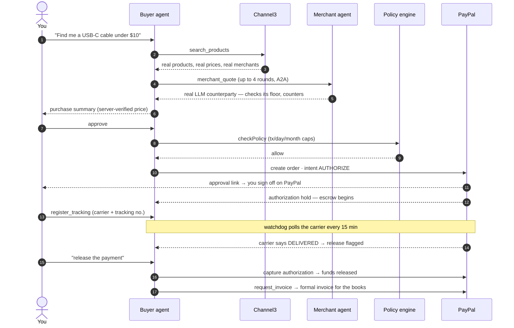
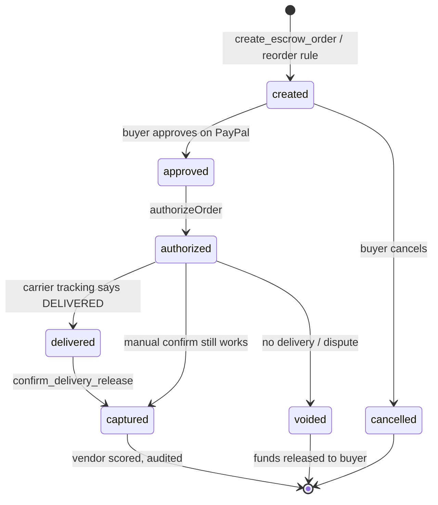
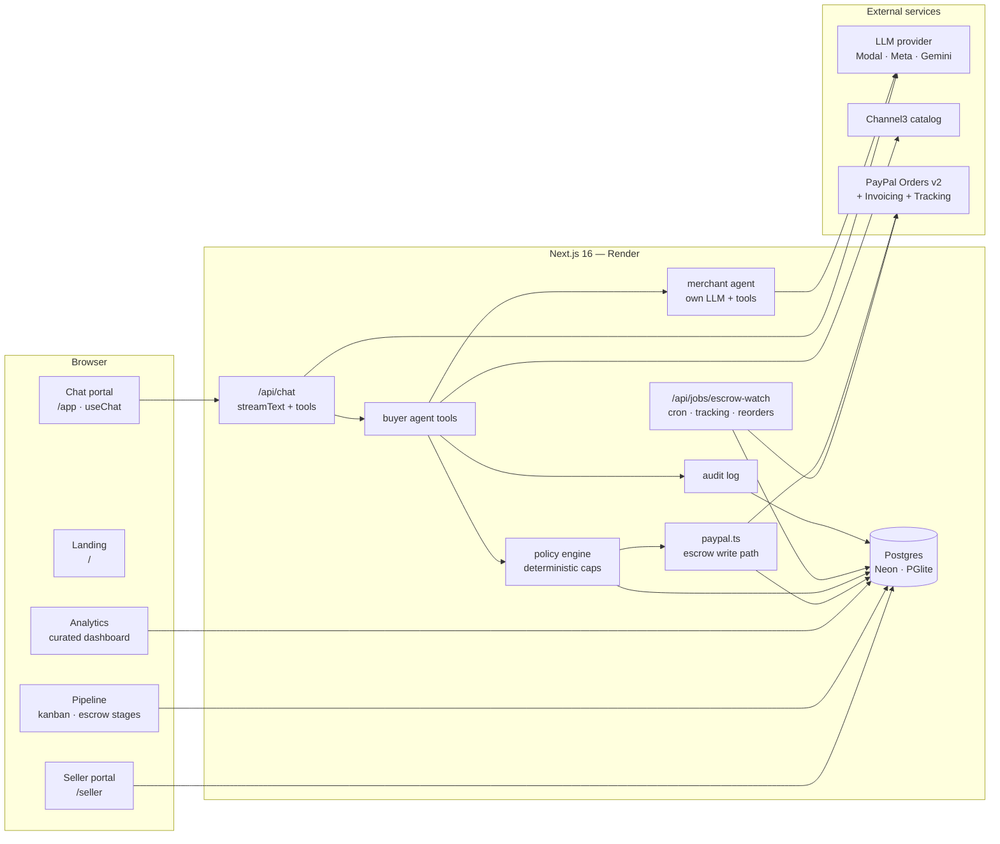

<p align="center">
  
</p>

<div align="center">


<br/>


<br/><br/>

**[What it is](#what-is-parley) · [How it works](#how-it-works) · [Why different](#why-it-is-different) · [Tools](#agent-tools) · [Architecture](#architecture) · [Security](#security-model) · [Quickstart](#quickstart) · [Deploy](#deploy) · [Roadmap](#roadmap)**

</div>


## What is Parley?

**Parley** is an agentic procurement platform for solopreneurs and
micro-businesses — the procurement department they can't afford. A *parley* is
a conference between two parties; here it's literal — a buyer agent negotiates
with merchant-side agents, and PayPal settles the deal.

An Etsy seller, a freelancer, a corner café — they all buy supplies, but none
of them have a procurement team. They overpay because they can't compare and
negotiate at scale, and they eat the risk when a vendor doesn't deliver: card
charges are instant, disputes are slow, and "buyer protection" is a claim
process, not a control. Parley inverts that — the agent compares and
negotiates, PayPal holds the funds in escrow, and money only moves when the
goods arrive.

> **Entry for the PayPal AI Hackathon.**

> [!IMPORTANT]
> **Verified working today** — live deployment on Render + Neon, real product
> search via Channel3, agent-to-agent negotiation against a real merchant-side
> LLM agent, deterministic policy gate, the full `AUTHORIZE → capture/void`
> escrow round-trip against PayPal sandbox, shipment-tracking-aware delivery
> detection, formal PayPal invoices, and an autonomous reorder engine guarded
> by the same policy. Nothing claimed here exceeds what the code does.


## How it works



If the goods never show up, the authorization is **voided** — the funds were
held, never captured. That's the difference between escrow and a chargeback.

### Escrow lifecycle




## Why it is different

Most "agentic commerce" demos are a chatbot glued to a checkout button. Parley
is built so the model can *propose* and only *code* can move money:

| Capability | What it means |
|---|---|
| **Prices never come from the model** | `create_escrow_order` resolves amounts server-side from the product cache or an accepted negotiation quote. The LLM selects a product ID — it cannot invent a number that reaches PayPal. |
| **Deterministic policy gates every order** | Per-tx, daily, and monthly caps live in `policies` and are evaluated in code (`src/lib/policy.ts`) — not in the prompt. The agent proposes; it cannot spend. |
| **Human approves every payment** | The PayPal approval link/button is the last mile. The agent never touches credentials. |
| **Capture only after delivery** | `AUTHORIZE` intent, never `CAPTURE`. Releasing funds is a separate, explicit, gated step. |
| **Shipment-aware escrow** | Register carrier tracking and the watchdog polls it every 15 min — when the carrier reports `DELIVERED`, the order flips and release is flagged. The escrow knows when the box lands. |
| **Everything is audited** | Actor, action, rationale, token count, and cost — append-only and rendered in the analytics workspace. |
| **A real counterparty — not a function** | `merchant_quote` negotiates against a merchant-side **LLM agent** with its own prompt, tools (`check_margin_floor`, `check_inventory`), and incentives. The floor is enforced server-side, so it can never sell below cost — whatever the model says. |
| **Two-sided marketplace** | Sellers deploy their own merchant agent — catalog, margin floor, negotiation style — and its deals land on their live feed, ledger, and lead radar. Buyer and seller agents meet over MCP/A2A; neither talks to the other's human. |
| **Market intelligence, not just sourcing** | The agent reports on demand — catalog depth, price spread, 90-day price trajectories — and watches products *or whole queries* for better offers, landing deals in the Inbox with links to act. |
| **Visual sourcing** | Attach a product photo — it's matched against the live catalog server-side and becomes sourcing context. The model never handles the raw bytes. |
| **Formal paper trail** | A negotiated purchase can mint a real PayPal invoice (create → send) for the escrowed amount — procurement documentation, not just a charge. |
| **Autonomous procurement** | Reorder rules per space ("reorder boxes monthly under $25") — the watchdog searches, applies policy, and prepares the `AUTHORIZE` order; the human approves in one click. Above the autonomous limit it only proposes. |
| **Spaces — cost-center isolation** | A freelancer per client, a shop per product line: each space gets its own spend policy, orders, chat history, analytics, and alerts. Vendor reputation stays global truth; quota stays per user. |

## Agent tools

| Tool | What it does |
|---|---|
| `search_products` | Live product search via Channel3 — title, price, merchant, URL. Results cache server-side; later tools can only reference these IDs. |
| `merchant_quote` | Agent-to-agent negotiation against a real merchant LLM agent — its own model call, its own tools, floor enforced server-side. Up to 4 rounds; an accepted quote becomes the order price. |
| `create_escrow_order` | Server-side price resolution → `checkPolicy` → PayPal `AUTHORIZE` order → local order + audit → approval URL. |
| `get_escrow_status` | Reads live PayPal status of an escrow order. |
| `register_tracking` | Attaches carrier + tracking number to an escrow order — registered on PayPal too. The watchdog then watches the shipment until `DELIVERED`. |
| `confirm_delivery_release` | Captures the authorization after delivery confirmation — the release valve of the escrow. |
| `void_escrow_order` | Voids the authorization — held funds return to the buyer untouched when goods never arrive. |
| `request_invoice` | Merchant issues a formal PayPal invoice (generate number → create → send to billing email) for the escrowed amount. |
| `create_reorder_rule` | Arms autonomous procurement: recurring query + unit-price cap + interval. Watchdog enforces policy + autonomous limit on every run. |
| `run_rfq` | Multi-vendor request-for-quote — fans a need out to N merchant agents in parallel and persists the winning quote as a negotiation. |
| `release_partial` | Partial escrow release — frees a percentage of the hold when only part of the order arrived or was accepted. |
| `market_report` | Demand intelligence for a product space: catalog depth, cross-merchant price spread, vendor reliability, and the benchmark product's real 90-day price trajectory. |
| `track_price` / `list_price_watches` / `stop_price_watch` | Arm, inspect, and retire watches — on a single product or a whole query. The watchdog scans every cycle and alerts the Inbox on drops and better offers. |
| `list_reorder_rules` / `list_orders` | Local mirrors — rules, PayPal IDs, status, amounts. |
| **PayPal Agent Toolkit** | Invoices, disputes (read-side — buyers open them in the Resolution Center, the agent monitors), transaction lookup, shipment tracking, payment insights — normalized to AI SDK v7, admin-only. |

## Architecture



### Repository layout

```
src/
├── app/
│   ├── page.tsx                  ← public landing page
│   ├── app/                      ← authenticated procurement portal (chat)
│   ├── analytics/                ← curated dashboard (KPIs, spend, vendors, alerts)
│   ├── pipeline/                 ← kanban board — orders grouped by escrow stage
│   ├── inbox/                    ← approvals, deliveries, deals — actionable alerts
│   ├── seller/                   ← merchant portal: catalog, agent feed, sales, leads
│   ├── settings/                 ← profile, spaces, appearance, spend policy
│   └── api/
│       ├── chat/                 ← agent loop: streamText + tools
│       ├── mcp/                  ← merchant agent served over JSON-RPC — real A2A boundary
│       ├── jobs/escrow-watch/    ← cron: reconcile · tracking · reorders · price watches
│       ├── jobs/run/             ← manual watchdog trigger for the signed-in user
│       ├── conversations/        ← isolated chat threads
│       ├── spaces/               ← space CRUD + active-space switch
│       ├── policy/               ← per-space spend policy read/update
│       ├── seller/               ← merchant profile, catalog, sales, leads
│       ├── export/               ← per-space orders as CSV
│       ├── paypal/return|cancel/ ← PayPal checkout return handlers
│       ├── analytics-data/       ← feeds the dashboard
│       └── pipeline-data/        ← feeds the kanban
├── lib/
│   ├── agent/
│   │   ├── system.ts             ← buyer agent system prompt + guardrails
│   │   ├── model.ts              ← shared model factory (buyer + merchant)
│   │   ├── merchant.ts           ← merchant-side LLM agent — real A2A counterparty
│   │   └── tools.ts              ← search / negotiate / escrow / tracking / invoice / reorder
│   ├── paypal.ts                 ← Orders v2 REST client — the only escrow write path
│   ├── paypal-toolkit.ts         ← Agent Toolkit: invoices, disputes, shipment, insights
│   ├── channel3.ts               ← product search, normalized to ProductCard
│   ├── policy.ts                 ← deterministic spend gate — tx/day/month caps
│   ├── spaces.ts                 ← cost-center isolation + active-space resolution
│   ├── audit.ts                  ← append-only action + token-cost log
│   ├── env.ts                    ← centralized server-side env access
│   └── db/
│       ├── schema.ts             ← policies · spaces · orders_local · reorder_rules · audit · vendor_scores · alerts
│       └── index.ts              ← Drizzle: Neon (DATABASE_URL) or PGlite fallback
├── render.yaml                   ← Render Blueprint — web service + env contract
└── neon.ts                       ← Neon project wiring
```

## Security model

These are invariants, not features — the code enforces them:

1. **Money amounts are never model output.** Server-side price resolution only.
2. **`checkPolicy` cannot be bypassed** — it runs before every PayPal call, and tool retries can't route around it.
3. **No `CAPTURE` before delivery confirmation.** Authorization and capture are separate API calls with separate gates.
4. **Idempotent writes** — every mutating PayPal call sends a fresh `PayPal-Request-Id`.
5. **Secrets stay server-side.** Only `NEXT_PUBLIC_*` variables reach the browser; the PayPal secret never does.
6. **Tool results are data.** The system prompt instructs the model to treat tool output as untrusted content, never as instructions.
7. **Audit never lies.** `audit()` wraps every consequential action and fails safe — a logging problem can never block or corrupt a payment path.
8. **Authenticated, role-gated spend.** Sessions are httpOnly + server-side (scrypt passwords, SHA-256'd tokens). Three tiers: `admin` (owner — adds the merchant-account PayPal toolkit), `user` (full buyer agent, spend gated by policy + human approval), `demo` (search + negotiate only, hard daily cap).
9. **The merchant's floor is law — not a suggestion.** The A2A merchant agent reasons freely, but the server clamps every decision: it can never accept or counter below its margin floor, whatever the model outputs.
10. **Autonomy is bounded and approved.** Reorder rules run inside `checkPolicy` + the per-space `autonomous_limit_cents`. Within bounds the agent prepares the order — a human still approves it on PayPal. Above the limit it can only propose.

## Database

Eighteen tables, one schema, two drivers — `ensureDb()` bootstraps DDL, seeds
the default policy, backfills a `Personal` space per user, and plants the
`Acme Supply Co.` demo merchant so every deployment ships with a live A2A
counterparty:

| Table | Purpose |
|---|---|
| `users` / `sessions` | Auth — scrypt passwords, hashed session tokens, admin/demo roles |
| `spaces` | Cost-center isolation — per-client or per-product-line boundaries |
| `policies` | Per-space caps: tx / daily / monthly, autonomous limit, vendor allowlists |
| `conversations` / `messages` | Isolated chat threads + history — scoped per user + space |
| `product_cache` / `negotiations` | Search context + A2A transcripts — server-side price truth |
| `orders_local` | Local mirror of PayPal order state — IDs, amounts, escrow stage, tracking, invoice |
| `reorder_rules` | Autonomous procurement — query, price cap, interval, enabled flag |
| `audit_log` | Append-only agent/system actions with rationale, tokens, cost |
| `vendor_scores` | Merchant reputation — global truth, shared across spaces |
| `alerts` | Watchdog findings — overdue delivery, DELIVERED, reorder proposals |
| `merchant_profiles` / `seller_products` | The user's own merchant agent — floor, style, catalog |
| `merchant_sales` / `seller_events` | The seller ledger — closed deals + every negotiation round, live |
| `price_watches` | Market surveillance — per-product or per-query targets the watchdog scans |

**Default policy** — `$250`/tx · `$750`/day · `$3,000`/month · `$50` autonomous limit.

## Design system

A restrained paper-and-ink palette with a single teal accent — procurement is
a trust product, so it looks like one.

| Token | Value | Use |
|---|---|---|
| `paper` | `#fafaf8` | Page background |
| `card` | `#ffffff` | Surfaces |
| `ink` | `#17150f` | Primary text |
| `ink-soft` | `#6b675c` | Secondary text |
| `line` | `#e8e5dd` | Hairline borders |
| `accent` | `#0f766e` | Brand + primary actions |
| `accent-strong` | `#115e59` | Hover / emphasis |
| `accent-soft` | `#d7f0ec` | Tinted fills |
| `ok` / `warn` / `danger` | `#15803d` / `#b45309` / `#b91c1c` | Escrow states, alerts |

Typography — **Space Grotesk** for display, **Inter** for UI text.

## Tech stack

| Layer | Technology |
|---|---|
| App | Next.js 16 (App Router, Turbopack) · React 19 · TypeScript · Tailwind v4 |
| Agent | Vercel AI SDK v7 — `streamText`, tools, `useChat` |
| LLM | Pluggable — **Modal** (GLM-5.3-Flash, dedicated endpoint) · **Meta Model API** (`muse-spark-1.3`) · **Gemini** fallback. Switch with `LLM_PROVIDER`. |
| Payments | PayPal Orders v2 (`AUTHORIZE`/`authorize`/`capture`/`void`) + Agent Toolkit + JS SDK buttons |
| Catalog | Channel3 product search API |
| Database | Neon Postgres (prod) · embedded PGlite (local) — same Drizzle schema |
| Analytics | Curated dashboard — KPIs, negotiation savings, order states, spend, vendor scores, alerts + AG Grid detail (`/analytics`) |
| Pipeline | Kanban board — orders grouped by escrow stage, overdue surfacing (`/pipeline`) |
| Inbox | Actionable alerts — approvals, deliveries, deals, leads — with manual watchdog trigger (`/inbox`) |
| Hosting | Render Blueprint (`render.yaml`) — web + `parley-escrow-watch` cron · health check `/api/health` |


## Quickstart

```bash
git clone https://github.com/HCHAPS404/PARLEY.git
cd parley
npm ci
cp .env.example .env.local   # fill in your keys
npm run dev                  # http://localhost:3000
```

First run bootstraps the local PGlite database automatically — no migrations needed.

<details>
<summary><strong>Environment variables</strong> — full reference</summary>

| Variable | Required | Notes |
|---|---|---|
| `PAYPAL_CLIENT_ID` / `PAYPAL_CLIENT_SECRET` | required | developer.paypal.com → Apps & Credentials → **Sandbox** app |
| `NEXT_PUBLIC_PAYPAL_CLIENT_ID` | required | Same client ID — exposed to the browser for PayPal JS SDK |
| `PAYPAL_ENV` | required | `sandbox` for the hackathon |
| `CHANNEL3_API_KEY` | required | Product catalog search |
| `LLM_PROVIDER` | required | `modal` \| `meta` \| `google` |
| `MODAL_API_KEY` / `MODAL_BASE_URL` / `MODAL_MODEL` | one LLM | Modal Shared Endpoint proxy token (`wk-….ws-…`) |
| `META_API_KEY` / `META_BASE_URL` / `META_MODEL` | one LLM | Meta Model API key (`LLM_…`), model `muse-spark-1.3` |
| `GOOGLE_GENERATIVE_AI_API_KEY` | one LLM | Gemini fallback |
| `DATABASE_URL` | prod only | Neon Postgres — empty = embedded PGlite locally |
| `CRON_SECRET` | prod only | Guards `/api/jobs/*` |
| `NEXT_PUBLIC_APP_URL` | prod only | e.g. `https://parley-wt1k.onrender.com` — PayPal return URLs |
| `NEXT_PUBLIC_AG_GRID_LICENSE` | optional | AG Grid Enterprise / AG Studio license |
| `NEXT_PUBLIC_BRYNTUM_LICENSE` | — | removed — pipeline is now a kanban |

</details>

<details>
<summary><strong>Commands</strong></summary>

```bash
npm run dev        # dev server (Turbopack)
npm run build      # production build
npm run start      # serve production build
npm run lint       # eslint
npx tsc --noEmit   # typecheck
npm test           # vitest — 24 invariant tests
```

</details>

## Testing the escrow flow (sandbox)

1. Talk to the agent: *"find me a USB microphone under $80"*
2. Negotiate — the merchant agent counters with its own reasoning (watch the transcript: that's a second LLM, not a template)
3. Confirm → the agent returns a PayPal approval link
4. Open it, log in with your **sandbox Personal** account, approve
5. Share a tracking number → *"track order <id> with UPS 1Z…"* — the watchdog flags release when the carrier reports delivered
6. *"release the payment"* → authorization captured · *"send me the invoice"* → formal PayPal invoice issued
7. Optional: *"reorder this every 30 days under $80"* → autonomous procurement armed

## Deploy

`render.yaml` is a complete Blueprint — Render builds with `npm ci && npm run
build`, serves `npm run start`, health-checks `/api/health`, and declares
every env var (`sync: false` secrets are entered once in the dashboard, never
in git). Point it at a Neon `DATABASE_URL` and the same schema bootstraps
itself in production.

```json
// GET /api/health on production
{"ok":true,"db":"postgres","configured":{"paypal":true,"llm":true,"channel3":true}}
```

## Business model

- **Free** — agent search + compare, manual checkout
- **Pro ~$19/mo** — autonomous negotiation, escrow orders, vendor scoring
- **Business ~$59/mo** — higher caps, multi-user policies, analytics workspace
- **Protection fee ~1%/tx** on escrow releases — cheaper than a chargeback
- **Affiliate revenue** via Channel3 merchant referrals

## Roadmap

- [x] Agent loop with real catalog + A2A negotiation against a real merchant LLM agent
- [x] Agentic escrow on PayPal (authorize → capture on delivery / void)
- [x] Deterministic spend policy + audit trail
- [x] Production deploy (Render + Neon) — landing site + authenticated portal
- [x] Auth with admin/demo roles — spend tools gated server-side
- [x] Durable state — product cache, negotiations, chat history in Postgres per user
- [x] Order dedup + per-user order isolation
- [x] Escrow watchdog cron — reconciles PayPal state, flags expiry + overdue delivery
- [x] Shipment-aware escrow — carrier tracking polled until DELIVERED
- [x] PayPal invoices issued for escrowed orders (create + send)
- [x] Autonomous reorder rules — policy-bounded, human-approved on PayPal
- [x] Spaces — per-client / per-product-line cost centers with isolated policies
- [x] Vendor scoring wired into merchant selection — capture bumps on_time, void bumps dispute
- [x] Two-sided marketplace — buyer + seller personas, own merchant agent per user, MCP/JSON-RPC A2A boundary
- [x] Multi-vendor RFQ — parallel sealed quotes, winner persisted as a negotiation
- [x] Partial escrow capture — release a fraction of the hold, tracked in `captured_cents`
- [x] Approval inbox — delivered releases, reorder approvals, invoice issuing, nav badge
- [x] Live seller feed — every negotiation round the merchant agent handles, in real time
- [x] PayPal webhook — real-time order reconciliation (signature verification pending)
- [x] CSV expense export per space
- [x] Isolated conversation threads — per-thread history, lazy migration
- [x] Multimodal chat — image attachments (4×2MB) feed visual product search
- [x] Market intelligence — `market_report`, 90-day price trajectories, price & deal watches → Inbox
- [x] Deal & lead radar — query watches scan for better offers; seller sees unclosed buyers + `buyer_walked` alerts
- [x] Close-rate KPI + bulk CSV catalog import for sellers
- [x] Actionable Inbox — product links on cards & deal alerts, manual "Check now" watchdog trigger
- [x] Onboarding checklist + kanban order pipeline
- [x] Order detail drawer — per-order escrow timeline, held/released amounts, negotiated savings
- [x] Member role — registered users get the full buyer agent; demo stays read-only
- [x] Error boundaries, OG share card, security headers, skeleton loading, a11y pass
- [x] 24 invariant tests — policy caps/allowlist, merchant floor law, demo tool surface, i18n parity
- [ ] Neon Realtime live dashboard updates


<div align="center">

Released under the [MIT License](LICENSE) · Copyright © 2026 Parley contributors

**Parley** — *agents that parley. PayPal that settles.*

</div>
